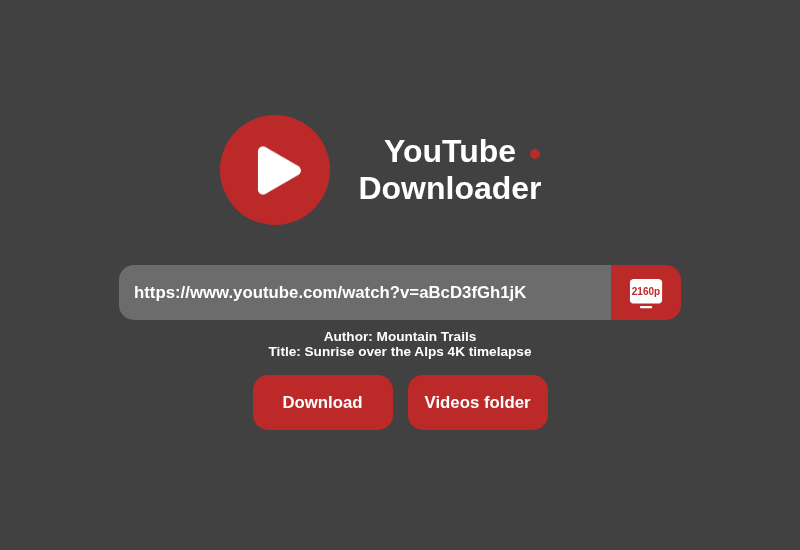
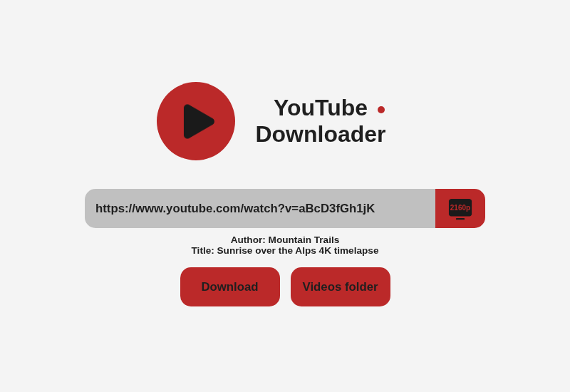
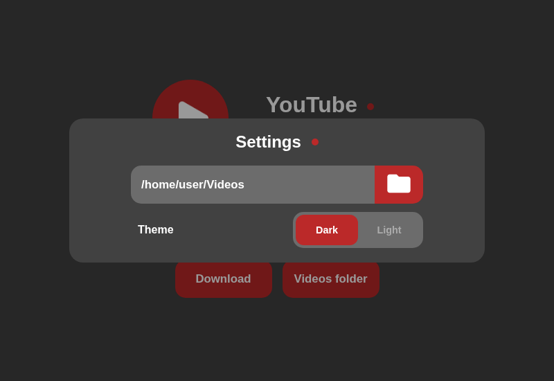
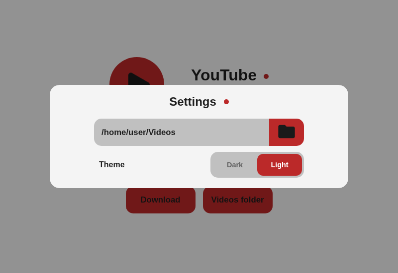

# YouTube Downloader

YouTube Downloader is a simple app that helps you download videos from YouTube in the highest available resolution
(up to 4K). The app opens in a **Google Chrome** or **Chromium** window, so one of these browsers must be installed —
without it the app will not start.

## Interface

The interface is fully responsive, intuitive and supports light and dark themes.

All settings are collected in one window:

## Launch

*Launch via [Python](https://www.python.org/) 3.10 or newer*

1. Download the archive of the **main** branch and unzip it.
2. Open the unzipped folder in the console.
3. Install the packages from requirements.txt: `pip install -r requirements.txt`
4. Run the command `python main.py`.

## How to use

### First launch

1. Click the small red dot next to the app's name to open **Settings**.
2. Set the folder where videos will be saved: type the path into the **Videos folder** field or click the folder
   button and choose it in the dialog.
3. Choose the **Dark** or **Light** theme.
4. Close the settings with the red dot next to the **Settings** title.

The folder and the theme are saved to `settings.json` and restored on the next launch, so you only need to do this
once.

### Downloading a video

When you load a video for the first time, the console will show the message
**"Please open https://www.google.com/device and input code ..."**. Open the link in the browser and register the
device. Without this, the app will not work properly.

1. Paste the video URL into the **Video url** field. The author and the title of the video will appear below.
2. Click the monitor button to the right of the field and choose a resolution. The highest available resolution is
   selected by default.
3. Click **Download** and wait until the status says the video has been downloaded.

### Other actions

* **Videos folder** — opens the folder with downloaded videos.
* **App icon** — opens YouTube in the browser.

## Other important things

The video is saved under its title. Characters that are not allowed in file names are replaced with spaces.

The video processing progress is displayed in the console. To stop downloading and processing a video you need to
close the console, but then the app logic will stop working too. So make sure you want to download a big video before
starting.

The download progress of a video that comes with an audio track is not displayed in the console. Progress is shown
only for videos that are supplied separately from the audio track.

Videos that come with an audio track download faster than videos without one, because the latter have to be merged
with the audio track after downloading.

Some videos cannot be downloaded in as high a resolution as presented on YouTube, it depends on the video.

At the moment, the app has a major disadvantage — it works in **one thread**. Keep this in mind when using the app.

If you have a dark theme extension enabled in the browser, the app may have a slightly **different color tint**.

## What was used in the development

* [Python 3.10](https://www.python.org/downloads/) and the following libraries:
    * [Eel](https://github.com/python-eel/Eel) was used to implement the app and communication with the web
      interface.
    * [Pytubefix](https://pypi.org/project/pytubefix/) was used for YouTube video download logic.
    * [MoviePy](https://github.com/Zulko/moviepy) was used to merge video and audio tracks.
    * [Tkinter](https://docs.python.org/3/library/tkinter.html) was used for the folder selection dialog.

* HTML for page markup.
* CSS for styling.
* JS for the logic of working with Python.
